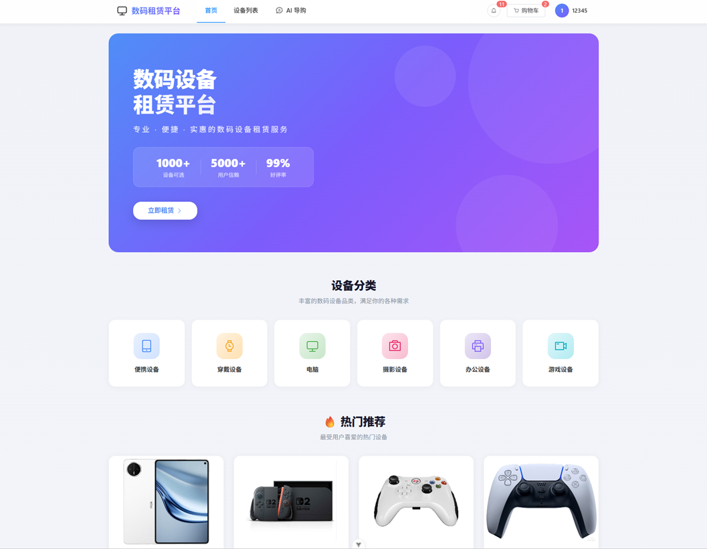
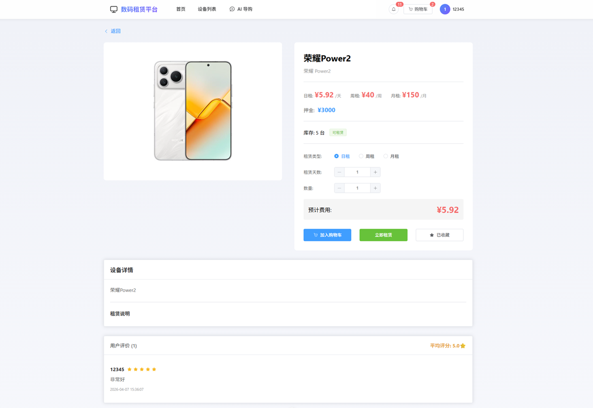
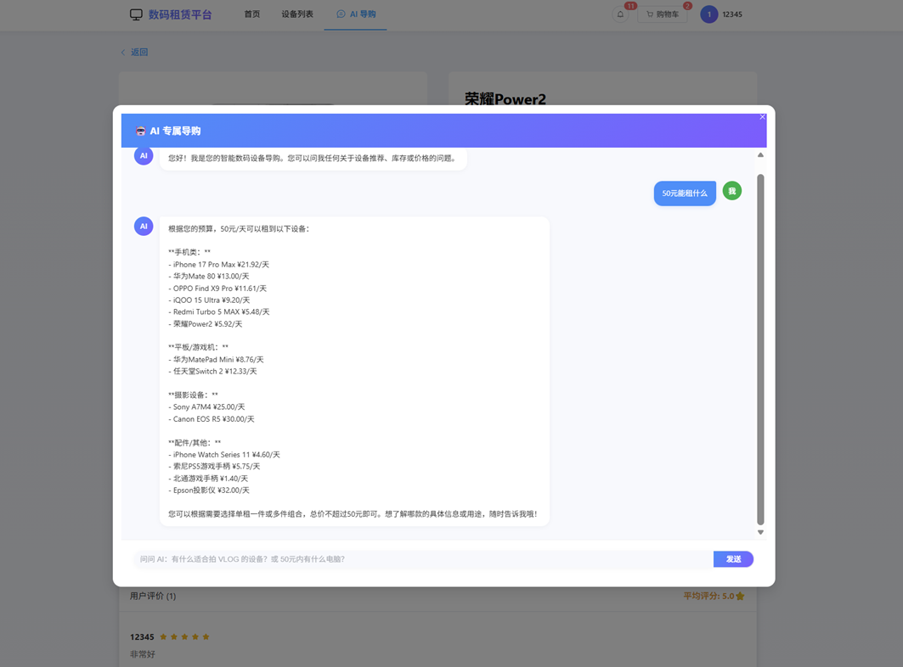
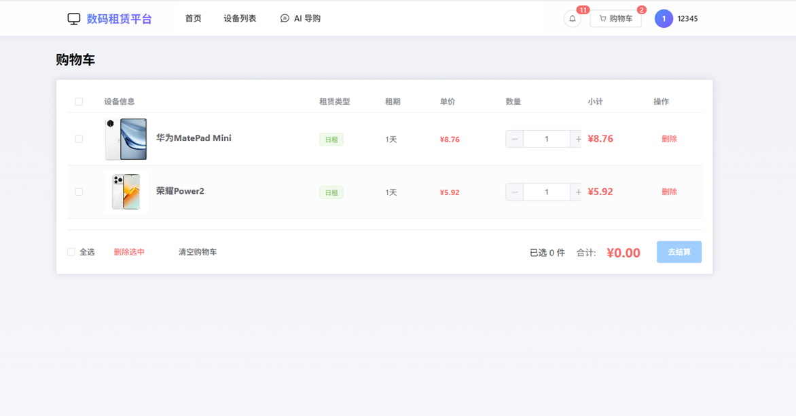
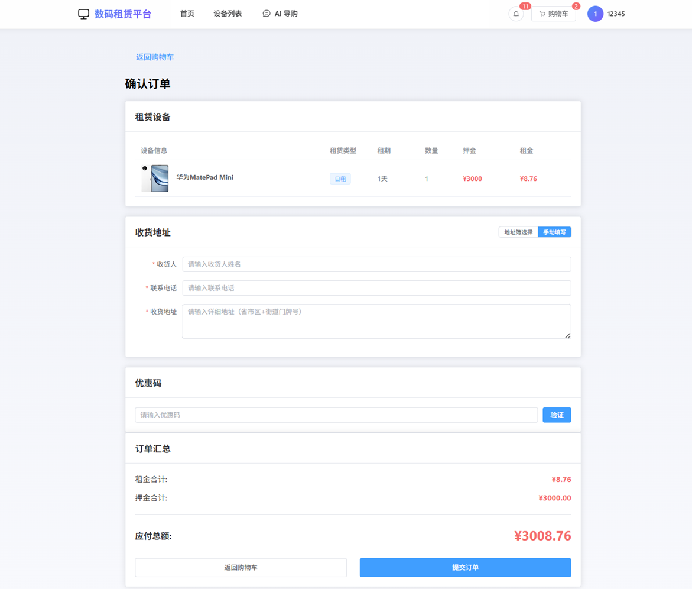
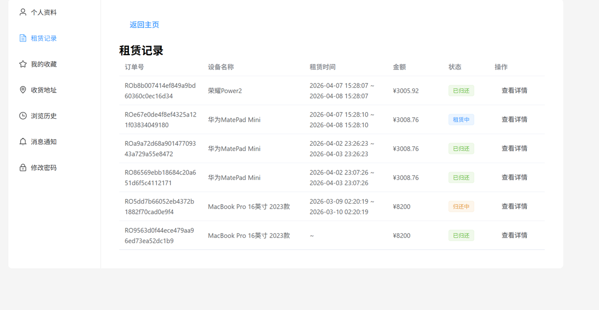
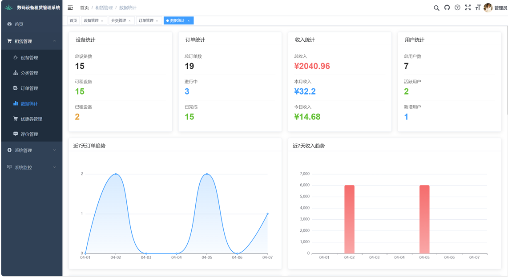
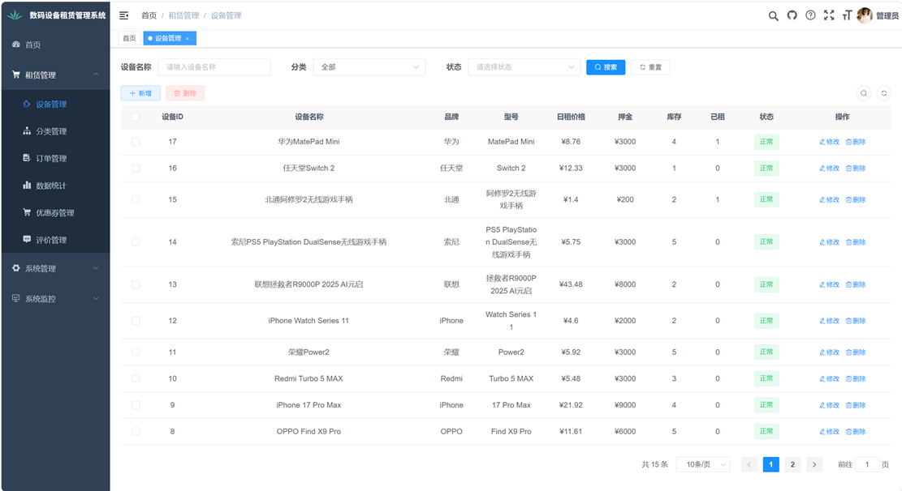
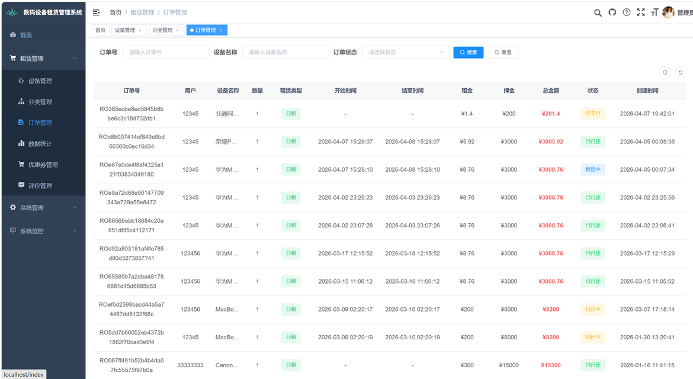
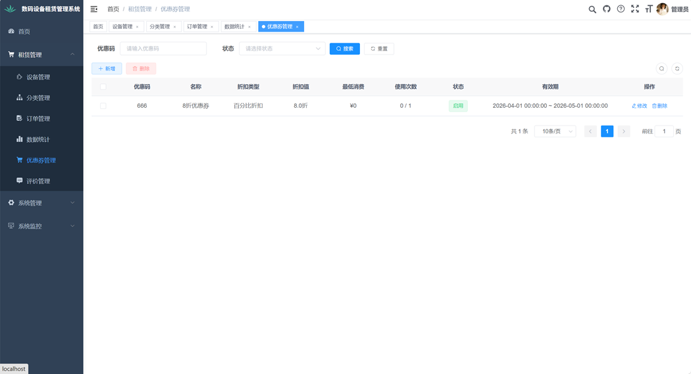

# 数码设备租赁平台

**Digital Equipment Rental Platform**

基于 Spring Boot + Vue 的前后端分离数码设备租赁系统 —— 覆盖「选品 → 下单 → 租赁 → 归还 → 结算」一体化业务闭环，并集成基于 DeepSeek 大语言模型的 AI 智能导购。

> 温州商学院 2026 届本科毕业设计 · 信息工程学院 · 计算机科学与技术
> 题目：基于 SpringBoot 的数码租赁平台的设计与实现


---

## 目录

- [项目简介](#项目简介)
- [界面预览](#界面预览)
- [功能一览](#功能一览)
- [实现范围说明](#实现范围说明)
- [技术栈](#技术栈)
- [系统架构](#系统架构)
- [项目结构](#项目结构)
- [快速开始](#快速开始)
- [关键配置](#关键配置)
- [接口约定](#接口约定)
- [数据库设计](#数据库设计)
- [技术亮点](#技术亮点)
- [后续规划](#后续规划)
- [说明与声明](#说明与声明)

---

## 项目简介

随着共享经济的发展，数码设备迭代速度快、单价高、闲置周期长，学生与年轻群体对高性能笔记本、相机、无人机等设备的**短期使用需求**持续增长，但直接购买成本高，传统线下租赁又存在流程不透明、押金风险大等问题。

本项目设计并实现了一个面向校园场景的数码设备租赁平台，以「设备浏览 → 选品下单 → 支付 → 租期管理 → 归还结算」为主线，用一套系统把**普通用户**与**平台管理员**两类角色的业务流程串联起来，并针对租赁行业的实际痛点补充了**租期延期、设备定损扣款、优惠券核销**等机制，形成完整的业务与资金闭环。

系统提供两个前端入口：

| 端 | 目录 | 面向对象 |
|---|---|---|
| 用户门户端 | `vue-portal` | 普通租赁用户（浏览、下单、归还、评价） |
| 后台管理端 | `ruoyi-ui` | 平台运营与管理人员（设备、订单、营销、统计） |

两端共享同一套后端 REST API，通过 JWT 实现无状态统一认证。

---

## 界面预览

**用户门户端**

| 首页（分类 + 热门推荐） | 设备详情（多档计价 + 评价） |
|---|---|
|  |  |

| AI 智能导购（基于实时库存推荐） | 购物车 |
|---|---|
|  |  |

| 订单结算 | 我的订单 |
|---|---|
|  |  |

**后台管理端**

| 数据统计看板 | 设备管理 |
|---|---|
|  |  |

| 订单管理与定损扣款 | 优惠券管理 |
|---|---|
|  |  |

---

## 功能一览

### 用户门户端

| 模块 | 说明 |
|---|---|
| 首页 | 轮播主视觉、设备分类导航、热门设备推荐 |
| 设备浏览 | 按分类 / 品牌 / 价格区间筛选，关键词模糊搜索，分页加载 |
| 设备详情 | 设备参数、日租 / 周租 / 月租三档计价与押金、库存、用户评价列表 |
| 购物车 | 加入购物车、修改租赁类型与天数、删除、费用实时试算、批量结算 |
| 订单中心 | 下单结算、支付、按状态筛选（待支付 / 已支付 / 租赁中 / 归还中 / 已归还 / 已取消）、订单详情 |
| 归还申请 | 填写归还快递公司与单号，订单流转为「归还中」 |
| 租期延期 | 租赁中的订单可申请延期，系统按日租金自动试算延期费用并等待管理员审批 |
| 评价反馈 | 订单完成后可对设备评分（1—5 星）并撰写文字评价，评价展示在设备详情页 |
| 我的收藏 | 收藏 / 取消收藏感兴趣的设备 |
| 消息中心 | 订单通知与系统消息，已读 / 未读管理 |
| 个人中心 | 资料维护、修改密码、租赁记录 |
| AI 智能导购 | 全局悬浮组件，自然语言提问，基于平台实时库存给出设备推荐 |

### 后台管理端

| 模块 | 说明 |
|---|---|
| 数据统计 | 设备 / 订单 / 收入 / 用户四项汇总指标，近 7 天订单与收入趋势图表 |
| 设备管理 | 设备增删改查、图片上传、上下架、多档价格与库存维护 |
| 分类管理 | 树形分类体系的增删改与排序，决定门户端分类导航结构 |
| 订单管理 | 全平台订单查询与筛选、确认发货、确认收货（自动恢复库存）、延期申请审批、损坏标记与定损扣款 |
| 优惠券管理 | 优惠券创建与配置（抵扣金额、最低消费门槛、有效期、最大使用次数），核销情况跟踪 |
| 系统管理 | 用户、角色、菜单、部门、岗位、字典、参数、公告、操作日志（RBAC 模型） |
| 系统监控 | 在线用户、定时任务、缓存监控、服务监控 |

---

## 实现范围说明

本项目以后端框架 RuoYi-Vue 3.9.1 为基座二次开发。为便于评审区分工作边界，特此说明：

| 模块 | 来源 | 说明 |
|---|---|---|
| 用户 / 角色 / 菜单 / 部门 / 岗位 / 字典 / 参数 / 公告 / 操作日志 | RuoYi 自带 | 未改动业务逻辑，仅按需配置菜单与角色数据 |
| 认证与鉴权（Spring Security 过滤器链、JWT、`@PreAuthorize`） | RuoYi 自带 | 沿用框架能力，未自行实现 |
| 定时任务（Quartz）、代码生成器 | RuoYi 自带 | 保留能力，未做二次开发 |
| **租赁业务后端**：设备 / 分类 / 购物车 / 订单 / 优惠券 / 收藏 / 评价 / 消息 / 统计 | **原创** | 9 个 Controller + domain / mapper / service，约 4200 行 |
| **订单状态机、租期延期审批、定损扣款、优惠券核销** | **原创** | 见 [技术亮点](#技术亮点) |
| **AI 智能导购**（`AiChatController` + 提示词组装） | **原创** | 实时库存注入 System Prompt，调用 DeepSeek |
| **用户门户端 `vue-portal`** | **原创** | Vue 3 + Vite 独立工程，全部页面与状态管理，约 5700 行 |
| 后台管理端 `ruoyi-ui` | RuoYi 自带 | 新增租赁业务页面 5 个（设备 / 分类 / 订单 / 统计 / 优惠券） |
| **数据库设计**（9 张 `rental_*` 业务表） | **原创** | 见 [数据库设计](#数据库设计) |

---

## 技术栈

### 后端

| 技术 | 版本 | 用途 |
|---|---|---|
| Java | 1.8 | 开发语言（Maven 编译级别 1.8） |
| Spring Boot | 2.5.15 | 应用框架、内嵌 Tomcat、自动配置 |
| Spring Security + JWT（jjwt） | — | 无状态认证、请求过滤链、接口鉴权 |
| MyBatis | — | 持久层，Mapper 接口 + XML 映射，PageHelper 分页 |
| MySQL | 8.0（InnoDB / utf8mb4） | 业务数据存储 |
| Druid | 1.2.27 | 数据库连接池与监控 |
| Redis | 6.x | 令牌存储与缓存（**必需依赖**） |
| Quartz | — | 定时任务调度 |
| Maven | 3.6+ | 多模块依赖管理与构建 |
| DeepSeek API | — | AI 智能导购大语言模型（HTTP 调用，OpenAI 兼容协议） |

### 前端

**用户门户端 `vue-portal`**

| 技术 | 版本 |
|---|---|
| Vue | 3.5（组合式 API） |
| Vite | 7 |
| Element Plus | 2.5（含自动按需引入） |
| Pinia | 2（含 persistedstate 持久化） |
| Vue Router | 4 |
| Axios | 1.x |

**后台管理端 `ruoyi-ui`**

| 技术 | 版本 |
|---|---|
| Vue | 2.6 |
| Element UI | 2.15 |
| Vuex / Vue Router | 3.x |
| ECharts | 5.x |
| Vue CLI | — |

> 后台管理端沿用 RuoYi 官方前端技术栈（Vue 2 + Element UI），用户门户端为全新独立开发的 Vue 3 + Vite 工程。

---

## 系统架构

```
┌───────────────────────────────┐   ┌───────────────────────────────┐
│  用户门户端  vue-portal        │   │  后台管理端  ruoyi-ui          │
│  Vue 3 + Vite + Element Plus  │   │  Vue 2 + Element UI + ECharts │
│  Pinia · Vue Router · Axios   │   │  Vuex · 动态菜单渲染            │
│  http://localhost:25642       │   │  http://localhost:80          │
└──────────────┬────────────────┘   └───────────────┬───────────────┘
               │  Vite 代理 /dev-api                 │  代理 /prod-api
               └────────────────┬────────────────────┘
                                ▼   HTTP / JSON
┌───────────────────────────────────────────────────────────────────┐
│                  Spring Boot 2.5.15（RuoYi 3.9.1）                 │
│                                                                   │
│   Controller  ──  Service  ──  Mapper（MyBatis + XML）             │
│                                                                   │
│   ├─ Spring Security + JwtAuthenticationTokenFilter  登录校验      │
│   ├─ @PreAuthorize 接口级鉴权 + 动态菜单              RBAC 权限    │
│   ├─ GlobalExceptionHandler + AjaxResult{code,msg,data} 统一返回   │
│   └─ AiChatController  实时库存 → System Prompt → DeepSeek         │
└──────────┬──────────────────────────┬─────────────────────────────┘
           │                          │
    ┌──────▼───────┐           ┌──────▼───────┐        ┌──────────────┐
    │  MySQL 8.0   │           │   Redis 6    │        │ DeepSeek API │
    │  28 张表      │           │ 令牌 / 缓存   │        │  AI 智能导购  │
    │ 9 张租赁业务表 │           └──────────────┘        └──────────────┘
    └──────────────┘
```

请求链路：前端 Axios 注入 `Authorization: Bearer <token>` → Spring Security 过滤器链解析令牌 → Controller 参数校验 → Service 事务内完成业务规则与库存变更 → Mapper 落库 → 统一封装为 `{code, msg, data}` 返回。

---

## 项目结构

```
rent/
├── ruoyi-admin/                        # 后端启动模块（Web 层）
│   └── src/main/
│       ├── java/com/ruoyi/
│       │   ├── RuoYiApplication.java    # 启动类
│       │   └── web/controller/
│       │       ├── rental/              # 租赁业务接口（10 个 Controller）
│       │       │   ├── AiChatController.java          # AI 智能导购
│       │       │   ├── RentalEquipmentController.java # 设备
│       │       │   ├── RentalCategoryController.java  # 分类
│       │       │   ├── RentalOrderController.java     # 订单（含延期 / 定损）
│       │       │   ├── RentalCartController.java      # 购物车
│       │       │   ├── RentalCouponController.java    # 优惠券
│       │       │   ├── RentalFavoriteController.java  # 收藏
│       │       │   ├── RentalReviewController.java    # 评价
│       │       │   ├── RentalMessageController.java   # 消息
│       │       │   └── RentalStatisticsController.java  # 数据统计
│       │       └── system/              # 系统管理接口
│       └── resources/
│           ├── application.yml          # 主配置（端口 / Redis / JWT / 上传路径）
│           ├── application-druid.yml    # 数据源配置
│           └── mybatis/                 # Mapper XML
├── ruoyi-common/                       # 通用工具模块（统一返回体、异常、注解、工具类）
├── ruoyi-framework/                    # 框架核心（Security / JWT / AOP / 拦截器）
├── ruoyi-system/                       # 业务模块
│   └── src/main/java/com/ruoyi/
│       ├── rental/                     # 租赁业务核心 domain / mapper / service
│       │   ├── domain/                 # 实体类 + vo
│       │   ├── mapper/                 # Mapper 接口
│       │   └── service/                # 业务逻辑与实现
│       └── system/                     # 系统管理业务
├── ruoyi-quartz/                       # 定时任务模块
├── ruoyi-generator/                    # 代码生成器
├── ruoyi-ui/                           # 后台管理端（Vue 2 + Element UI）
│   └── src/
│       ├── api/                        # 接口请求
│       ├── views/rental/               # 租赁业务页面（设备 / 分类 / 订单 / 统计 / 优惠券）
│       └── components/  router/  store/
├── vue-portal/                         # 用户门户端（Vue 3 + Vite）
│   └── src/
│       ├── api/                        # ai / auth / cart / category / equipment
│       │                               # favorite / message / order / review
│       ├── views/                      # 首页 / 设备列表 / 设备详情 / 购物车 / 结算
│       │                               # 订单列表 / 订单详情
│       │   └── UserCenter/             # 个人中心（资料 / 改密 / 收藏 / 消息 / 租赁记录）
│       ├── components/Layout/          # MainLayout（含全局 AI 导购悬浮组件）
│       ├── stores/                     # Pinia：user / cart
│       ├── router/  utils/
├── sql/
│   └── rent.sql                        # 建表语句 + 演示数据（业务表 + 若依基础表 + 菜单）
├── docs/images/                        # README 界面截图
├── DEPLOYMENT.md                       # 详细部署指南
├── LICENSE                             # MIT（源自 RuoYi 开源项目）
└── pom.xml                             # Maven 父级 POM
```

---

## 快速开始

### 环境要求

| 依赖 | 版本要求 | 说明 |
|---|---|---|
| JDK | 1.8+ | 项目编译级别为 1.8 |
| Maven | 3.6+ | 多模块构建 |
| MySQL | 8.0（5.7+ 亦可） | 字符集 utf8mb4 |
| **Redis** | 5.0+ | **必须启动**，若依的令牌与缓存依赖 Redis |
| Node.js | 管理端 ≥ 14；门户端 ≥ 20.19 或 ≥ 22.12 | 两端的 Node 要求不同，建议使用 22 LTS |

### 1. 初始化数据库

```bash
# 创建数据库（默认库名 rent）
mysql -u root -p -e "CREATE DATABASE rent DEFAULT CHARACTER SET utf8mb4 COLLATE utf8mb4_general_ci;"

# 导入表结构与演示数据（包含业务表、若依基础表与菜单权限数据）
mysql -u root -p rent < sql/rent.sql
```

### 2. 启动 Redis

```bash
redis-server
```

### 3. 配置并启动后端

```bash
# 1) 生成本地私有配置（该文件已被 .gitignore 忽略，不会提交）
cd ruoyi-admin/src/main/resources
cp application-local.yml.example application-local.yml      # Windows 用 copy

# 2) 编辑 application-local.yml，填入本机 MySQL 账号密码、JWT 密钥与图片上传目录

# 3) 安装各模块到本地仓库
cd ../../../..
mvn clean install -DskipTests

# 4) 启动后端
cd ruoyi-admin
mvn spring-boot:run
```

> 数据库地址、账号、密码、JWT 密钥、上传目录均支持**环境变量注入**
> （`MYSQL_HOST` / `MYSQL_PORT` / `MYSQL_USERNAME` / `MYSQL_PASSWORD` / `JWT_SECRET` / `RENTAL_UPLOAD_DIR`），
> 未设置时回落到配置文件中的占位默认值。

后端启动于 <http://localhost:8080>（`server.address=localhost`，仅监听本机）。

### 4. 启动后台管理端

```bash
cd ruoyi-ui
npm install
npm run dev
```

后台管理端启动于 <http://localhost:80>，默认使用 `admin / admin123` 登录（若依内置管理员账号）。

### 5. 启动用户门户端

```bash
cd vue-portal
npm install
npm run dev
```

用户门户端启动于 <http://localhost:25642>（Vite 已配置 `/dev-api` → `http://localhost:8080` 代理，无需处理跨域）。

### 6. 演示说明

| 端 | 账号 | 密码 |
|---|---|---|
| 后台管理端 | `admin` | `admin123` |
| 用户门户端 | 通过注册页自行创建 | — |

系统默认开启用户注册（`sys.account.registerUser = true`），也可在后台「系统管理 → 用户管理」中新增用户，初始密码由参数 `sys.user.initPassword` 控制（默认 `123456`）。

> 演示数据仅用于本地功能验证，请勿直接用于公网环境。

---

## 关键配置

| 配置项 | 配置文件 | 默认值 / 说明 |
|---|---|---|
| 服务端口 | `application.yml` | `server.port: 8080` |
| 数据库地址 | `application-druid.yml` | `${MYSQL_HOST:localhost}:${MYSQL_PORT:3306}/rent` |
| 数据库账号 | `application-druid.yml` | `${MYSQL_USERNAME:root}` |
| 数据库密码 | `application-druid.yml` | `${MYSQL_PASSWORD:YOUR_MYSQL_PASSWORD}`，**占位符** |
| Redis 地址 | `application.yml` | `spring.redis.host: localhost`，`port: 6379`，无密码 |
| JWT 密钥与有效期 | `application.yml` | `${JWT_SECRET:...}` **占位符** / `token.expireTime`（分钟，默认 30） |
| 文件上传目录 | `application.yml` | `${RENTAL_UPLOAD_DIR:./uploadPath}` |
| 上传大小限制 | `application.yml` | 单文件 10MB / 单次请求 20MB |
| 本地私有配置 | `application-local.yml` | 覆盖上述各项，**已被 `.gitignore` 忽略**，模板见 `application-local.yml.example` |
| AI 服务密钥 | — | 启用 AI 智能导购前需自行配置 DeepSeek API Key，**仓库不提供** |

### 安全注意事项

- 仓库中**不包含**任何数据库密码、JWT 密钥或第三方 API Key：相关配置项一律写成
  `${ENV_NAME:默认占位符}` 形式，真实值放在本地 `application-local.yml` 中，该文件已被 `.gitignore` 忽略。
- 部署到服务器时请通过环境变量注入敏感信息，例如：

  ```bash
  export MYSQL_USERNAME=rent MYSQL_PASSWORD='强密码' JWT_SECRET='<随机长字符串>' RENTAL_UPLOAD_DIR=/home/rent/uploadPath
  java -jar ruoyi-admin.jar
  ```

- 用户密码使用 BCrypt 加密存储，接口不返回任何明文凭证。

---

## 接口约定

### 认证方式

除登录、注册、验证码等匿名接口外，所有请求需在请求头携带令牌：

```
Authorization: Bearer <token>
```

用户门户端将令牌持久化在 `localStorage`，由 Axios 请求拦截器自动注入；后端基于 Spring Security 过滤器链校验，令牌失效（默认 30 分钟）需重新登录。

### 统一响应体

```json
{
  "code": 200,
  "msg": "success",
  "data": {}
}
```

| code | 含义 |
|---|---|
| 200 | 请求成功 |
| 401 | 未登录 / 令牌失效或过期 |
| 403 | 无权限访问该资源 |
| 500 | 服务端异常 / 业务校验失败 |

分页查询接口返回 `{ code, msg, rows, total }`，分页参数为 `pageNum` / `pageSize`。

### 前缀与代理

后端接口**不使用额外上下文前缀**（`context-path: /`）。开发环境下由前端代理转发：

| 端 | 前端请求前缀 | 代理目标 |
|---|---|---|
| 用户门户端 | `/dev-api` | `http://localhost:8080` |
| 后台管理端 | `/prod-api` | `http://localhost:8080` |

业务接口示例：`GET /rental/equipment/list`（设备分页列表）、`GET /rental/equipment/hot`（热门设备）、`POST /rental/order`（创建订单）、`POST /rental/ai/chat`（AI 智能导购）。

### 在线接口文档

后端集成 Springfox Swagger3（`application.yml` 中 `swagger.enabled: true`），启动后访问
<http://localhost:8080/swagger-ui/index.html> 即可查看全部接口并直接调试。

---

## 数据库设计

数据库共 28 张表：**9 张租赁业务表** + 19 张若依基础表（用户、角色、菜单、部门、字典、日志等）。其中租赁业务表覆盖用户、设备与分类、租赁交易、营销与评价四大板块。

| 表名 | 说明 | 关键字段 |
|---|---|---|
| `sys_user` | 用户表（管理端与门户端共用） | `user_id`、`user_name`、`password`（BCrypt）、`nick_name`、`phonenumber`、`status` |
| `rental_category` | 设备分类表（树形结构） | `category_id`、`category_name`、`parent_id`、`sort_order`、`status` |
| `rental_equipment` | 设备信息表 | `equipment_id`、`equipment_name`、`category_id`、`brand`、`model`、`main_image`、`daily_price` / `weekly_price` / `monthly_price`、`deposit`、`stock`、`status` |
| `rental_order` | 租赁订单表（核心业务表） | `order_no`、`user_id`、`equipment_id`、`rental_type`、`rental_days`、`total_amount`、`receiver_*`、`return_express_*`、`status`、`coupon_code`、`discount_amount`、`extend_days` / `extend_fee` / `extend_status`、`is_damaged` / `damage_fee` / `damage_reason` |
| `rental_cart` | 购物车表 | `cart_id`、`user_id`、`equipment_id`、`quantity`、`rental_type`、`rental_days` |
| `rental_favorite` | 收藏表 | `favorite_id`、`user_id`、`equipment_id` |
| `rental_coupon` | 优惠券表 | `coupon_code`（唯一）、`discount_amount`、`min_spend`、`valid_until`、`max_uses`、`current_uses` |
| `rental_review` | 设备评价表 | `review_id`、`order_id`、`equipment_id`、`user_id`、`rating`（1—5）、`content` |
| `rental_message` | 消息通知表 | `user_id`、消息内容与已读状态 |
| `rental_payment` | 支付记录表 | 订单支付流水 |

### 关键字段取值

| 字段 | 取值 |
|---|---|
| `rental_order.status` | `0` 待支付 / `1` 已支付 / `2` 租赁中 / `3` 归还中 / `4` 已归还 / `5` 已取消 |
| `rental_order.rental_type` | `1` 日租 / `2` 周租 / `3` 月租 |
| `rental_order.extend_status` | `0` 无 / `1` 申请中 / `2` 已同意 / `3` 已拒绝 |
| `rental_order.is_damaged` | `0` 未损坏 / `1` 已损坏（触发押金扣减） |
| `sys_user.status` | `0` 正常 / `1` 停用 |

物理设计上，核心表统一使用 InnoDB 存储引擎与 utf8mb4 字符集；设备表的分类字段、订单表的用户字段均建立索引以提升关联查询效率。

---

## 技术亮点

### 1. 订单状态机与事务一致性

订单全生命周期状态流转：

```
待支付 → 已支付 → 租赁中 → 归还中 → 已归还
   └──────────── 已取消 ────────────┘
```

下单时「写入订单 + 扣减库存 + 核销优惠券」在同一个 `@Transactional` 事务内完成，任一步失败整体回滚；管理员确认收货后系统自动回补设备库存，形成完整的租赁闭环。

### 2. 租期延期与定损扣款（租赁资产风险闭环）

- **延期**：租赁中的订单可申请延期，系统按日租金自动试算延期费用，经管理员审批后自动延长租赁周期并将费用计入订单总额。
- **定损**：管理员确认收货时可标记设备损坏、录入损坏原因与赔偿金额，系统自动从押金中扣减，并更新订单定损字段，避免人工核算误差。

### 3. 优惠券核销引擎

优惠券以唯一优惠码发行，核销时完整校验「是否过期 / 是否达到使用上限 / 是否满足最低消费门槛」，校验通过后自动重算订单金额并累加已使用次数，规则集中收敛在 Service 层。

### 4. AI 智能导购（提示词工程 + 实时库存）

系统未对大语言模型做微调训练，而是采用**后端中转代理 + 提示词工程**的方案：

1. 用户在前端悬浮对话框中以自然语言提问；
2. 后端实时查询数据库中状态为「已上架」的设备，组装为结构化文本注入 System Prompt；
3. 转发至 DeepSeek API，解析响应后返回前端渲染。

这使得 AI 的推荐**始终以平台真实库存与价格为依据**，管理员新增或下架设备后推荐内容即时同步，无需重新训练模型；同时对注入设备数量与 `max_tokens` 做限制，控制单次调用的 Token 消耗与响应延迟。前端将导购组件挂载于全局布局，用户在任意页面都可随时唤起，不打断当前操作。

### 5. 双端共享一套后端 API

用户门户端与后台管理端为两个独立前端工程，共享同一套 REST 接口与统一的 JWT 认证体系。业务逻辑只在后端实现一次，两端仅负责呈现与交互，避免逻辑重复。

### 6. RBAC 权限与动态菜单

基于「用户 — 角色 — 菜单」模型实现权限控制：角色绑定菜单权限，用户可关联多个角色并取权限并集；前端根据后端返回的权限集合动态渲染侧边菜单与操作按钮，无权限项自动隐藏，实现各岗位的操作隔离。

### 7. 数据可视化看板

后台首页集成 ECharts 可视化面板，通过 MyBatis 分组聚合查询（`GROUP BY`）统计设备、订单、收入、用户四类核心指标，并以折线图 / 柱状图呈现趋势，为运营决策提供量化依据。

---

## 后续规划

- **在线支付**：对接微信支付、支付宝，替代当前的模拟支付流程。
- **物流追踪**：集成快递 100 等物流查询 API，依据归还快递单号自动同步物流状态。
- **库存并发控制**：库存扣减补充 `stock >= #{quantity}` 条件与影响行数校验（乐观锁），进一步提升高并发下的数据准确性。
- **自动化测试**：为订单创建、库存扣减、优惠券核销等核心链路补充单元测试与集成测试。
- **AI 能力升级**：引入多模态大模型，支持用户上传设备损坏照片自动识别损伤程度并给出定损建议金额。
- **架构演进**：业务规模扩大后向微服务拆分（用户 / 设备 / 订单服务），并以 Redis 分布式锁替代数据库行锁，提升高并发下的库存扣减吞吐量。

---

## 说明与声明

- 本项目为**温州商学院本科毕业设计**成果，用于学习与技术交流，作者保留著作权。
- 项目后端与后台管理端基于开源框架 [RuoYi-Vue](https://gitee.com/y_project/RuoYi-Vue)（MIT License）二次开发，保留原项目 `LICENSE` 与版权声明；用户门户端与租赁业务模块为原创实现。
- 项目中的品牌标识、设备图片等第三方素材不随仓库分发，如需本地演示请自行准备并放置于上传目录。
- 演示账号与演示数据仅用于本地功能验证，部署到公网前请务必删除或修改。

---

<p align="center"><sub>温州商学院 · 信息工程学院 · 计算机科学与技术 · 2026 届本科毕业设计</sub></p>
